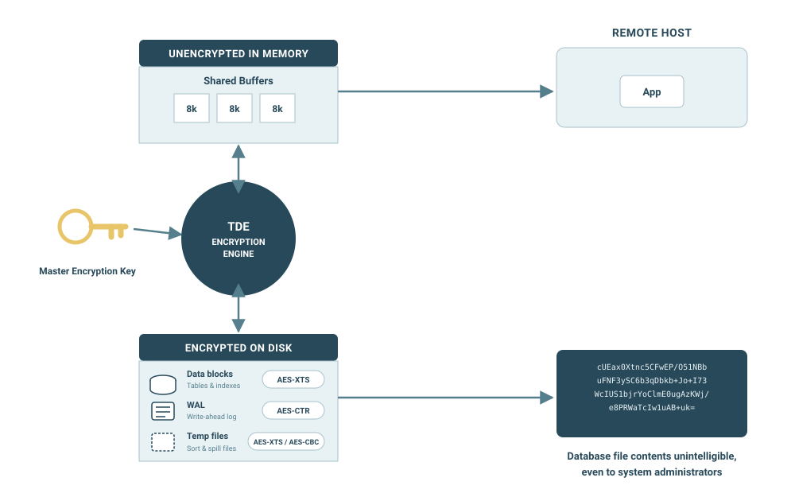

Transparent data encryption (TDE) is an optional feature supported by [Enterprise Postgres (Oracle Compatible)](/epas/latest/), formerly EDB Postgres Advanced Server, and [Enterprise Postgres](/pge/latest/), formerly EDB Postgres Extended Server, from version 15. 

It encrypts any user data stored in the database system, including the data in tables and other objects as well as system catalog data such as object names. This encryption is transparent to the user, requiring no changes to applications or client drivers, and it protects sensitive data at rest to support common data privacy and security compliance requirements.

  

