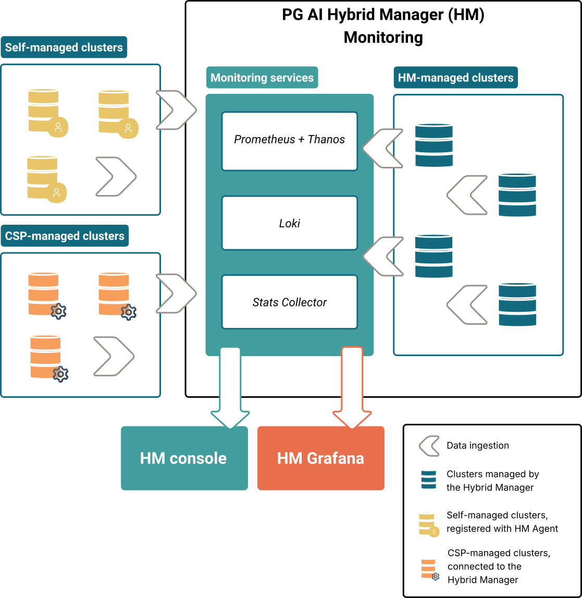

# Monitoring with Hybrid Manager

With Hybrid Manager (HM), you can collect a wide range of metrics (host metrics, Kubernetes metrics, Postgres database data, query data, and logging data). You can visualize the collected data with the HM console or Grafana instance to analyze trends, configure alerting, improve the efficiency of databases, perform troubleshooting, and much more.

## Understanding the monitoring architecture

HM has three main internal pipelines that provide monitoring capabilities:

- Prometheus and Thanos collect metrics.
- Loki collects logs.
- Stats Collector collects query data.

All these services come with their own dedicated stores, which means that the collected data is kept in HM. These services and stores are deployed by default.

These collected metrics become available to you through two interfaces:

- The [**Grafana**](https://www.enterprisedb.com/docs/edb-postgres-ai/1.4/hybrid-manager/using_hybrid_manager/monitoring/monitoring_grafana/) dashboard.
- The [**HM console**](https://www.enterprisedb.com/docs/edb-postgres-ai/1.4/hybrid-manager/using_hybrid_manager/monitoring/monitoring_console/), for example, in the **Estate** tab or [**Cluster** view](https://www.enterprisedb.com/docs/edb-postgres-ai/1.4/hybrid-manager/using_hybrid_manager/cluster_management/view_clusters/).

### Enabling database monitoring

The monitoring services that come with HM require access to the databases you want to monitor, as well as some extensions to enable Stats Collector.

- For HM-managed clusters (created with the HM), the default setup provides access to the monitoring stack.

- For external self-managed clusters, each of the databases must be [registered with the EDB Postgres AI agent](https://www.enterprisedb.com/docs/edb-postgres-ai/1.4/hybrid-manager/using_hybrid_manager/monitoring/mon_ext_dbs/mon_with_agent/) to enable data collection. By default, the agent provides the configuration to collect Prometheus, Thanos, and Loki data. Additionally, the agent provides configuration parameters so you can control whether to enable or disable the extensions required for Stats Collector (collection of query data), namely `edb_wait_states_data`, `edb_stat_monitor`, `edb_query_advisor`, and `pg_stat_statements`.

- For external cloud service provider (CSP)-managed databases, such as AWS RDS, HM needs to get access to the database through a Kubernetes `secret` resource to enable data collection. See [Monitoring CSP-managed databases](https://www.enterprisedb.com/docs/edb-postgres-ai/1.4/hybrid-manager/using_hybrid_manager/monitoring/mon_ext_dbs/mon_ext_csp/) for more information. Query data with Stats Collector isn't currently available for CSP-managed databases.

### Monitoring data ingestion and scope

Because of the different levels of access HM has to the variety of cluster types, the way that data is ingested and the scope of collected data varies.

- For HM-managed clusters (created with HM), the databases push host metrics, Postgres metrics, cluster metrics, query metrics, data required for recommendations, and logs to the corresponding Prometheus, Thanos, Loki, and Stats Collector stores.

- For external self-managed databases, the agent pushes host metrics, Postgres metrics, cluster metrics, query metrics, data required for recommendations, and logs to the corresponding Prometheus, Thanos, and Stats Collector stores at configurable intervals.

- For external CSP-managed databases, such as AWS RDS, HM leverages the HM-to-database connection to pull host and Postgres metrics to the central stores. Query data with Stats Collector isn't currently available for CSP-managed databases.

- For automated compliance: HM server transmits usage report to EDB for core-based licensing and entitlement tracking across all on-premises servers, eliminating manual audits.

For more information, see [Metrics support scope](https://www.enterprisedb.com/docs/edb-postgres-ai/1.4/hybrid-manager/using_hybrid_manager/monitoring/monitoring_console/support_scope/).

### Monitoring refresh frequency

The refresh intervals for the metrics that are collected by HM vary depending on the metric and database type. This difference is due to the varying methods of data collection and integration of Prometheus/Thanos, Loki, and Stats Collector services.

See [Metrics refresh intervals](https://www.enterprisedb.com/docs/edb-postgres-ai/1.4/hybrid-manager/using_hybrid_manager/monitoring/monitoring_console/metrics_latency/) to understand how often metrics are updated and how to customize the frequency.

## Connecting data into external tools

Currently, EDB doesn't support plugging metrics and log data collected by HM into external tools or enterprise systems.

## Related topics

- [Enabling monitoring](https://www.enterprisedb.com/docs/edb-postgres-ai/1.4/hybrid-manager/using_hybrid_manager/monitoring/mon_ext_dbs/) ► Install the agent or connect your database to HM to enable monitoring on external databases.
- [Enabling HM server monitoring](https://www.enterprisedb.com/docs/edb-postgres-ai/1.4/hybrid-manager/using_hybrid_manager/monitoring/monitoring_hm_server/)  ► Enable usage reporting in the HM server.
- [Metrics refresh intervals](https://www.enterprisedb.com/docs/edb-postgres-ai/1.4/hybrid-manager/using_hybrid_manager/monitoring/monitoring_console/metrics_latency/) ► Understand how often metrics are updated and how to customize the frequency.
- [Monitoring with Grafana](https://www.enterprisedb.com/docs/edb-postgres-ai/1.4/hybrid-manager/using_hybrid_manager/monitoring/monitoring_grafana/) ► Use Grafana to monitor your databases.
- [Monitoring with HM console](https://www.enterprisedb.com/docs/edb-postgres-ai/1.4/hybrid-manager/using_hybrid_manager/monitoring/monitoring_console/) ► Use the HM console to monitor your databases.
- [Notifications](https://www.enterprisedb.com/docs/edb-postgres-ai/1.4/hybrid-manager/using_hybrid_manager/monitoring/notifications/) ► Configure notifications.
- [Activity Log](https://www.enterprisedb.com/docs/edb-postgres-ai/1.4/hybrid-manager/using_hybrid_manager/monitoring/activity_log/) ► Audit platform events across your organization or project.

* [External databases](https://www.enterprisedb.com/docs/edb-postgres-ai/1.4/hybrid-manager/using_hybrid_manager/monitoring/mon_ext_dbs/): Learn about monitoring external databases with Hybrid Manager.
* [HM console](https://www.enterprisedb.com/docs/edb-postgres-ai/1.4/hybrid-manager/using_hybrid_manager/monitoring/monitoring_console/): Learn how to view database metrics with the Hybrid Manager console.
* [Grafana monitoring](https://www.enterprisedb.com/docs/edb-postgres-ai/1.4/hybrid-manager/using_hybrid_manager/monitoring/monitoring_grafana/): Learn about monitoring with Grafana for Hybrid Manager.
* [Usage report in HM server](https://www.enterprisedb.com/docs/edb-postgres-ai/1.4/hybrid-manager/using_hybrid_manager/monitoring/monitoring_hm_server/): Learn how to enable usage reporting in the HM server.
* [Notifications](https://www.enterprisedb.com/docs/edb-postgres-ai/1.4/hybrid-manager/using_hybrid_manager/monitoring/notifications/): Learn about monitoring and notifications with Hybrid Manager.
* [Alerts](https://www.enterprisedb.com/docs/edb-postgres-ai/1.4/hybrid-manager/using_hybrid_manager/monitoring/alerts/): Learn about monitoring and alerts with Hybrid Manager.
* [Activity Log](https://www.enterprisedb.com/docs/edb-postgres-ai/1.4/hybrid-manager/using_hybrid_manager/monitoring/activity_log/): Learn how to use the Activity Log to audit events across your Hybrid Manager organization or project.

> For an AI-friendly overview of our documentation, see [llms.txt](https://www.enterprisedb.com/docs/llms.txt).
