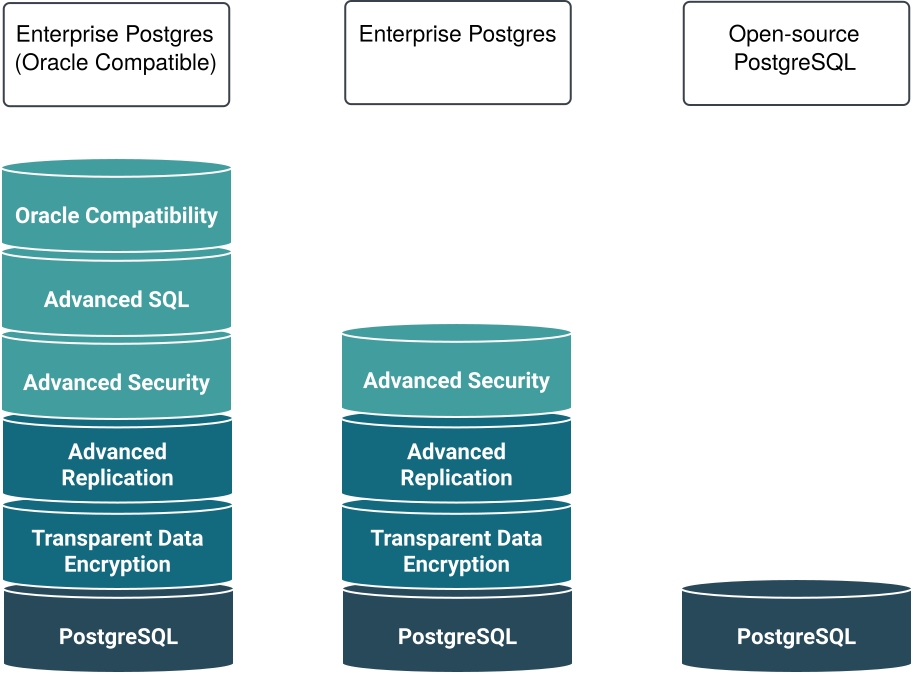

# Choosing your Postgres

EDB builds upon the upstream open-source [PostgreSQL](https://www.postgresql.org/) project, enhancing it with additional capabilities designed to support a wider range of use cases and enterprise requirements.

 

  

## Postgres distributions

### Enterprise Postgres (Oracle Compatible)

Also known as EDB Postgres Advanced Server (EPAS).

Enterprise Postgres (Oracle Compatible) builds on the features of Enterprise Postgres and supports features such as [advanced security](https://www.enterprisedb.com/docs/epas/latest/epas_security_guide/), [advanced SQL](https://www.enterprisedb.com/docs/epas/latest/application_programming/15_enhanced_sql_and_other_misc_features/) and, optional, [Oracle compatibility](https://www.enterprisedb.com/docs/epas/latest/working_with_oracle_data/).

You can obtain Enterprise Postgres (Oracle Compatible) from our [EDB repository](https://www.enterprisedb.com/software-downloads-postgres), for which you require an EDB account and license.

### Enterprise Postgres

Also known as EDB Postgres Extended Server (PGE).

Enterprise Postgres adds a number of features to PostgreSQL to support [transparent data encryption](https://www.enterprisedb.com/docs/edb-postgres-ai/platforms-and-tools/security/tde/).

Enterprise Postgres can also be combined with and fully utilize EDB's powerful high-availability and multi-master replication solution, [EDB Postgres Distributed](https://www.enterprisedb.com/docs/pgd/latest/).

You can obtain Enterprise Postgres from our [EDB repository](https://www.enterprisedb.com/software-downloads-postgres), for which you require an EDB account and license.

### PostgreSQL

PostgreSQL offers all the features gathered in the [PostgreSQL documentation](https://www.postgresql.org/docs/current/).

You can obtain PostgreSQL from our [EDB repository](https://www.enterprisedb.com/software-downloads-postgres), for which you require an EDB account and license. Alternatively, you can download it from the [official PostgreSQL site](https://www.postgresql.org/download/).

## More details

For a deep dive into the features and their support per Postgres option, see [Feature support per distribution](https://www.enterprisedb.com/docs/edb-postgres-ai/databases/feature_support_per_db/), [Advanced replication](https://www.enterprisedb.com/docs/edb-postgres-ai/databases/advanced_replication/), [Advanced security](https://www.enterprisedb.com/docs/edb-postgres-ai/databases/advanced_security/), [Advanced SQL](https://www.enterprisedb.com/docs/edb-postgres-ai/databases/advanced_sql/), [Advanced performance](https://www.enterprisedb.com/docs/edb-postgres-ai/databases/advanced_performance/), [Oracle support](https://www.enterprisedb.com/docs/edb-postgres-ai/databases/oracle_compatibility/), [Tools and extensions](https://www.enterprisedb.com/docs/edb-postgres-ai/databases/tools_extensions/), [Deployment options](https://www.enterprisedb.com/docs/edb-postgres-ai/databases/deployment_options/) and more.

> For an AI-friendly overview of our documentation, see [llms.txt](https://www.enterprisedb.com/docs/llms.txt).
