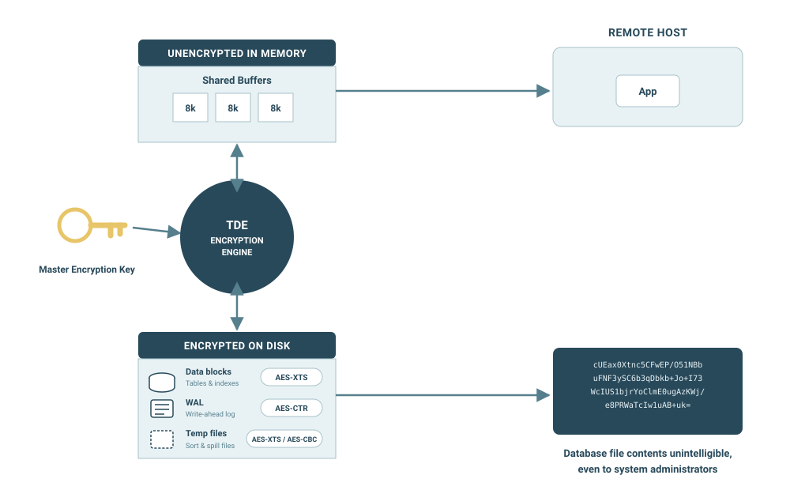

# Transparent Data Encryption

Transparent data encryption (TDE) is an optional feature supported by [Enterprise Postgres (Oracle Compatible)](https://www.enterprisedb.com/docs/epas/latest/), formerly EDB Postgres Advanced Server, and [Enterprise Postgres](https://www.enterprisedb.com/docs/pge/latest/), formerly EDB Postgres Extended Server, from version 15.

It encrypts any user data stored in the database system, including the data in tables and other objects as well as system catalog data such as object names. This encryption is transparent to the user, requiring no changes to applications or client drivers, and it protects sensitive data at rest to support common data privacy and security compliance requirements.

  

- [Overview](https://www.enterprisedb.com/docs/edb-postgres-ai/platforms-and-tools/security/tde/about/): Learn about TDE, how it works, what it encrypts, and why to use it.

## Setting up TDE

- [Choosing a key protection mechanism](https://www.enterprisedb.com/docs/edb-postgres-ai/platforms-and-tools/security/tde/secure_key/): Learn how to secure your data with an encryption key.
- [Creating a new cluster](https://www.enterprisedb.com/docs/edb-postgres-ai/platforms-and-tools/security/tde/self-managed/): Understand how to initialize a TDE-encrypted cluster on a self-managed database server.
- [Upgrading and encrypting](https://www.enterprisedb.com/docs/edb-postgres-ai/platforms-and-tools/security/tde/upgrading/): Learn about the supported pg\_upgrade use cases for enabling TDE, migrating to TDE, and upgrading TDE-enabled databases.
- [Migrating from PostgreSQL](https://www.enterprisedb.com/docs/edb-postgres-ai/platforms-and-tools/security/tde/postgres_to_extended/): Use pg\_upgrade to move a community PostgreSQL cluster to Enterprise Postgres (Oracle Compatible) or Enterprise Postgres while enabling TDE.

## Operating TDE

- [Maintaining the data encryption key](https://www.enterprisedb.com/docs/edb-postgres-ai/platforms-and-tools/security/tde/key_maintenance/): Learn how to protect or rotate the data encryption key on an already TDE-enabled cluster.
- [Working with encrypted files](https://www.enterprisedb.com/docs/edb-postgres-ai/platforms-and-tools/security/tde/encrypted_files/): How to work with files in an encrypted environment.
- [Reference](https://www.enterprisedb.com/docs/edb-postgres-ai/platforms-and-tools/security/tde/reference/): Reference material for TDE, including commands affected by TDE, initdb, pg\_upgrade, WAL file, and backup file options, limitations, and how to verify TDE is enabled.

> For an AI-friendly overview of our documentation, see [llms.txt](https://www.enterprisedb.com/docs/llms.txt).
