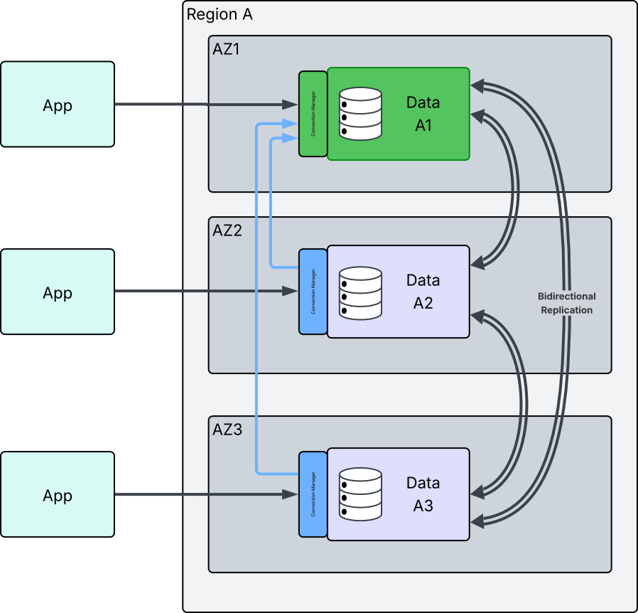

# Architecture

EDB Postgres Distributed (PGD) is a distributed database solution that extends PostgreSQL's capabilities, enabling highly available and fault-tolerant database deployments across multiple nodes.
PGD provides data distribution with advanced conflict management, data-loss protection, high availability up to five 9s, and throughput up to 5X faster than native logical replication.

PGD is built on a multi-master foundation (bi-directional replication, or BDR) which is then optimized for performance and availability through Connection Manager.
You can run PGD without Connection Manager if you need a custom deployment better utilizing the multi-master functionality. When running without Connection Manager, writes are distributed among the nodes and replicated to one another, and conflict resolution is relied upon for maintaining consistency.
This can be more efficient depending on your architectural needs. However, Connection Manager ensures lower contention and conflict through the use of a write leader.
[Raft](https://en.wikipedia.org/wiki/Raft_\(algorithm\)) is implemented to help the system make important decisions, like deciding which node is the Raft election leader and which node is the write leader.

## High-level architecture

At the highest level, PGD comprises two main components: Bi-Directional Replication (BDR) and Connection Manager.
BDR is a Postgres extension that enables a multi-master replication mesh between different BDR-enabled Postgres instances/nodes.
[Connection Manager](https://www.enterprisedb.com/docs/pgd/latest/connection-manager/) sends requests to the write leader—ensuring a lower risk of conflicts (stronger consistency) between nodes.

The below diagram shows 3 application nodes and 3 PGD nodes. Traffic is being directed from each of the PGD nodes by the Connection Manager to the write leader node.

Changes are replicated directly, row-by-row between all nodes.
[Logical replication](https://www.enterprisedb.com/docs/pgd/6.2/overview/terminology/#logical-replication) in PGD is asynchronous by default, so only eventual consistency is guaranteed (within seconds usually).
However, [commit scope](https://www.enterprisedb.com/docs/pgd/latest/commit-scopes/commit-scopes/) options offer immediate consistency and durability guarantees via [CAMO](https://www.enterprisedb.com/docs/pgd/latest/commit-scopes/camo/), [group](https://www.enterprisedb.com/docs/pgd/latest/commit-scopes/group-commit/) and [synchronous](https://www.enterprisedb.com/docs/pgd/latest/commit-scopes/synchronous_commit/) commits.

The Raft algorithm provides a mechanism for electing leaders (both Raft leader and write leader), deciding which nodes to add or subtract from the cluster. It generally ensures that the distributed system remains consistent and fault tolerant, even in the face of node failures.

## Architectural elements

PGD comprises several key architectural elements that work together to provide its distributed database solution:

- **PGD nodes**: These are individual Postgres instances that store and manage data. They are the basic building blocks of a PGD cluster.

- **Groups**:  By default, all nodes are also members of a [top-level group](https://www.enterprisedb.com/docs/pgd/6.2/node_management/groups_and_subgroups/#groups) with its own Raft leader but without a write leader. PGD nodes can be further organized into [subgroups](https://www.enterprisedb.com/docs/pgd/6.2/node_management/groups_and_subgroups/#sub-groups), which enhance manageability and high availability. Each group can contain multiple nodes, allowing for redundancy and failover within the group. Groups facilitate organized replication and data consistency among nodes within the same group and across different groups. Each group has its own write leader.

- **Replication mechanisms**: PGD's replication mechanisms include BDR for efficient replication across nodes, enabling multi-master replication. BDR supports asynchronous replication by default but can be configured for varying levels of synchronicity, such as [Group Commit](https://www.enterprisedb.com/docs/pgd/latest/commit-scopes/group-commit/) or [Synchronous Commit](https://www.enterprisedb.com/docs/pgd/latest/commit-scopes/synchronous_commit/), to enhance data durability.

- **Monitoring tools**: To monitor performance, health, and usage with PGD, you can use its [built-in command-line interface](https://www.enterprisedb.com/docs/pgd/latest/reference/cli/) (CLI), which offers several useful commands. For example:

  - The [`pgd nodes list`](https://www.enterprisedb.com/docs/pgd/latest/reference/cli/command_ref/nodes/list/) command provides a summary of all nodes in the cluster, including their state and status.
  - The [`pgd cluster show --health`](https://www.enterprisedb.com/docs/pgd/latest/reference/cli/command_ref/cluster/show/#options) command checks the health of the cluster, reporting on node accessibility, replication slot health, and other critical metrics.
  - The [`pgd events show`](https://www.enterprisedb.com/docs/pgd/latest/reference/cli/command_ref/events/show/) command lists significant events like background worker errors and node membership changes, which helps in tracking the operational status and issues within the cluster.

  Furthermore, the BDR extension allows for monitoring your cluster using SQL using the [`bdr.monitor`](https://www.enterprisedb.com/docs/pgd/6.2/security/pgd-predefined-roles/#bdr_monitor) role.

### Node types

All nodes in PGD are effectively data nodes. They vary only in their purpose in the cluster.

- **[Data nodes](https://www.enterprisedb.com/docs/pgd/latest/nodes/overview/#data-nodes)**: Store and manage data, handle read and write operations, and participate in replication.

There are then three types of nodes which, although built like a data node, have a specific purpose. These are:

- **[Subscriber-only nodes](https://www.enterprisedb.com/docs/pgd/latest/nodes/subscriber_only/)**: Subscribe to changes from data nodes for read-only purposes. Used in reporting or analytics.

- **[Witness nodes](https://www.enterprisedb.com/docs/pgd/latest/nodes/witness_nodes/)**: Participate in the consensus process without storing data, aiding in achieving quorum and maintaining high availability.

- **[Logical standby nodes](https://www.enterprisedb.com/docs/pgd/latest/nodes/logical_standby_nodes/)**: Act as standby nodes that can be promoted to data nodes if needed, ensuring high availability and disaster recovery.

### Node roles

Data nodes in a group can also take on particular roles to enable particular features.
These roles are transient and can be transferred to any other capable node in the group if needed.
These roles can include:

- **Raft leader**: Arbitrates and manages consensus between a group's nodes.

- **[Write leader](https://www.enterprisedb.com/docs/pgd/6.2/overview/terminology/#write-leader)**: Receives all write operations when applications connect through the connection manager.

## Architectural flexibility

PGD offers flexible options with how its architecture can be deployed, maintained, and scaled to meet various performance, availability, and compliance needs.

PGD supports rolling maintenance, including blue/green deployments for both Postgres upgrades and other system or application-level changes. This approach ensures that the database remains available during routine tasks, such as minor or major version upgrades, schema changes, and vacuuming operations. The system seamlessly switches between active database versions, achieving zero downtime.

PGD provides automatic failover to ensure high availability. If a node in the cluster becomes unavailable, another node takes over its responsibilities, minimizing downtime. Also, PGD includes self-healing capabilities, where nodes that have failed or disconnected reconnect to the cluster and resume normal operations once the issue is resolved.

PGD allows for selective replication, enabling users to replicate only a subset of data to specific nodes. This feature can be used to optimize performance by reducing unnecessary data traffic between nodes or to meet regulatory requirements, such as geographical data restrictions. For instance, a healthcare application might only replicate patient data within a specific region to comply with local data privacy laws.

With commit scopes, PGD also provides configurable durability. Accordingly, durability can be increased from the default asynchronous behavior and tuned using various configurable commit scopes:

- **[Synchronous Commit](https://www.enterprisedb.com/docs/pgd/latest/commit-scopes/synchronous_commit/)**: Works a lot like PostgreSQL’s synchronous\_commit option in its underlying operation. Requires writing to at least one other node at COMMIT time but can be tuned to require all nodes.

- **[CAMO](https://www.enterprisedb.com/docs/pgd/latest/commit-scopes/camo/)** (Commit At Most Once): Works by tracking each transaction with a unique ID and using a pair of nodes to confirm the transaction's outcome, ensuring the application knows whether to retry the transaction or not.

- **[Group Commit](https://www.enterprisedb.com/docs/pgd/latest/commit-scopes/group-commit/)**: An experimental commit scope, the goal of which is to protect against data loss in case of single-node failures of temporary outages by requiring more than one PGD node to successfully confirm a transaction at COMMIT time.

- **[Lag Control](https://www.enterprisedb.com/docs/pgd/latest/commit-scopes/lag-control/)**: If replication is running outside of set limits (taking too long for another node to be replicated to), a delay is injected into the node that originally received the transaction, slowing things down until other nodes have caught up.

## Architecture types

You can deploy a cluster in a wide range of architectures, including:

- [Standard/One-location](https://www.enterprisedb.com/docs/pgd/6.2/planning/architecture/standard/): A single PGD cluster with three nodes in the same data center or availability zone.
- [Near/far](https://www.enterprisedb.com/docs/pgd/6.2/planning/architecture/near-far/): Designed for a single location that needs to be reasonably highly available and needs to be able to recover from a disaster. It does this by having a two-data-node cluster in the primary location and a single data node in a secondary location.
- [Always-on](https://www.enterprisedb.com/docs/pgd/6.2/planning/architecture/always-on/): A single PGD cluster with two or more groups in the same data center or availability zone. This architecture is designed for high availability and disaster recovery, ensuring that the database remains operational even if one group fails. Only available for PGD Expanded.
- [Multi-location](https://www.enterprisedb.com/docs/pgd/6.2/planning/architecture/multi-location/): A single PGD cluster with two or more groups in different data centers or availability zones.  Only available for PGD Expanded.
- [Geo-distributed](https://www.enterprisedb.com/docs/pgd/6.2/planning/architecture/geo-distributed/): A single PGD cluster with two or more groups in different regions, like a multi-location architecture but with higher latency and potential network partitioning issues. Only available for PGD Expanded.

* [Architecture and performance](https://www.enterprisedb.com/docs/pgd/6.2/planning/architecture/architecture-and-performance/): EDB Postgres Distributed architectural options and performance characteristics.
* [Standard architecture](https://www.enterprisedb.com/docs/pgd/6.2/planning/architecture/standard/): Learn about the PGD standard architecture.
* [Near/far](https://www.enterprisedb.com/docs/pgd/6.2/planning/architecture/near-far/): Learn about the PGD near-far architecture.
* [Always-On](https://www.enterprisedb.com/docs/pgd/6.2/planning/architecture/always-on/): Learn about the PGD always-on architecture.
* [Multi-Location](https://www.enterprisedb.com/docs/pgd/6.2/planning/architecture/multi-location/): Learn about the PGD multi-location architecture.
* [Geo-Distributed](https://www.enterprisedb.com/docs/pgd/6.2/planning/architecture/geo-distributed/): Learn about the PGD geo-distributed architecture.

> For an AI-friendly overview of our documentation, see [llms.txt](https://www.enterprisedb.com/docs/llms.txt).
