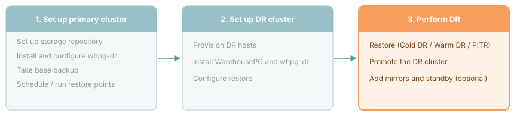

# Choosing and executing a recovery method

Choose the recovery scenario that matches your infrastructure and recovery objectives. For an explanation of RTO, RPO, and other key concepts, see [Concepts](https://www.enterprisedb.com/docs/supported-open-source/warehousepg/whpg-dr/overview/concepts/).

## Recovery scenarios

- **[Cold DR](https://www.enterprisedb.com/docs/supported-open-source/warehousepg/whpg-dr/performing-disaster-recovery/cold-dr/)** — The DR cluster doesn't exist until a failure occurs. You restore on demand from a base backup and WAL. Infrastructure cost is lowest, but Recovery Time Objective (RTO) is highest because provisioning and a full restore are required when a failure occurs.

- **[Point-in-time recovery (PITR)](https://www.enterprisedb.com/docs/supported-open-source/warehousepg/whpg-dr/performing-disaster-recovery/pitr/)** — You restore the cluster to a specific named restore point: for example, to roll back data corruption caused by a bad ETL load or an accidental `DROP TABLE`. The DR cluster may or may not be pre-provisioned. PITR requires restore points created in advance on the primary cluster.

- **[Warm DR](https://www.enterprisedb.com/docs/supported-open-source/warehousepg/whpg-dr/performing-disaster-recovery/warm-dr/)** — You provision the DR cluster in advance and replay WAL at a regular interval to keep it current. The cluster stays in recovery mode until you promote it. RTO is low because most of the WAL is already applied when a failure occurs.

* [Cold DR](https://www.enterprisedb.com/docs/supported-open-source/warehousepg/whpg-dr/performing-disaster-recovery/cold-dr/): Restore a WarehousePG cluster on demand from a base backup and WAL when a failure occurs.
* [Point-in-time recovery](https://www.enterprisedb.com/docs/supported-open-source/warehousepg/whpg-dr/performing-disaster-recovery/pitr/): Restore a WarehousePG cluster to a specific restore point to recover from data corruption or accidental data loss.
* [Warm DR](https://www.enterprisedb.com/docs/supported-open-source/warehousepg/whpg-dr/performing-disaster-recovery/warm-dr/): Keep a DR cluster continuously current by scheduling restore-point creation on the primary and delta WAL replay on the DR cluster.

> For an AI-friendly overview of our documentation, see [llms.txt](https://www.enterprisedb.com/docs/llms.txt).
