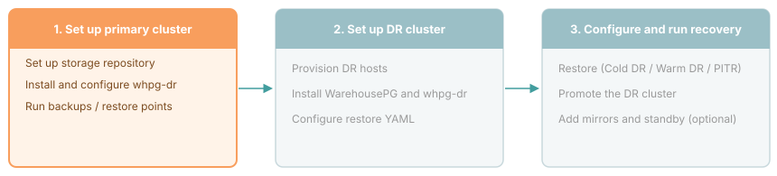

# Setting up the primary cluster for WarehousePG Disaster Recovery

Get the primary cluster protected and ready for disaster recovery. Set up the storage repository, install and configure `whpg-dr` on the primary cluster, and start taking backups.

## Steps

1. [Set up the storage repository](https://www.enterprisedb.com/docs/supported-open-source/warehousepg/whpg-dr/setting-up-primary/storage/) — provision an NFS share or S3 bucket that both clusters can reach. The primary cluster writes to it and the DR cluster reads from it.

2. [Install and configure the primary cluster](https://www.enterprisedb.com/docs/supported-open-source/warehousepg/whpg-dr/setting-up-primary/configuring-primary/) — install the `whpg-dr` package, create a backup configuration file, and run `whpg-dr configure backup` to enable WAL archiving.

3. [Perform backups](https://www.enterprisedb.com/docs/supported-open-source/warehousepg/whpg-dr/setting-up-primary/backups/) — run backups and restore points. At least one backup must exist before the DR cluster can be configured.

Once the primary is backing up, set up the DR cluster and choose a recovery scenario. See [Choosing a recovery method](https://www.enterprisedb.com/docs/supported-open-source/warehousepg/whpg-dr/performing-disaster-recovery/).

- [Setting up the storage repository](https://www.enterprisedb.com/docs/supported-open-source/warehousepg/whpg-dr/setting-up-primary/storage/): Set up the storage repository that the primary cluster archives WAL to and the DR cluster restores from.
- [Installing and configuring the primary cluster](https://www.enterprisedb.com/docs/supported-open-source/warehousepg/whpg-dr/setting-up-primary/configuring-primary/): Install the whpg-dr package and configure backup storage on the primary WarehousePG cluster.
- [Performing backups](https://www.enterprisedb.com/docs/supported-open-source/warehousepg/whpg-dr/setting-up-primary/backups/): Take base backups and create restore points on the primary cluster to prepare for disaster recovery.

> For an AI-friendly overview of our documentation, see [llms.txt](https://www.enterprisedb.com/docs/llms.txt).
